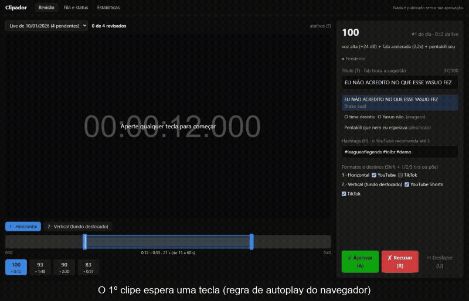
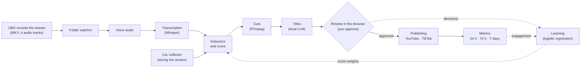

# Clipador: live stream clipper

*[Leia em português](README.md)*

[](https://github.com/Fermontelos/Clipador/actions/workflows/ci.yml)


[](LICENSE)

A Python app that turns live stream recordings (OBS) into clips for YouTube and TikTok.
Processing runs overnight; in the morning you review the clips with the keyboard in a local
web UI; and **nothing is published without your approval**. Over time, the app learns from
your approvals and from audience engagement which moments make good clips.

A personal and portfolio project, built only with free tools and APIs. The code, the docs and
the UI are in Portuguese (the author is Brazilian and streams in Portuguese); this page is an
English overview.



The whole flow in one minute, on the demo: [video (MP4, no sound)](docs/imagens/demo.mp4).

## What it does

- **Finds the best moments on its own**: three detectors (plugins) scan the whole stream:
  peaks in the streamer's voice, expressions in the transcript (Whisper) and League of Legends
  events collected during the match, aligned to the second in the video. Each moment gets a
  score from 0 to 100.
- **Cuts in three formats**: horizontal, vertical with a blurred background, and vertical with
  the webcam on top and the game below; burned-in captions, audio without the music
  (copyright) and loudness normalized to the platforms' standard.
- **Suggests titles and hashtags** with a local LLM (Ollama), in the streamer's own style, at
  no cost.
- **Keyboard-driven review**: approve, reject, undo, adjust the cut, change the title.
- **Publishes what you approved**: on YouTube, private and scheduled (Shorts and regular
  videos); on TikTok, to a folder or as a draft in the app. There are 10 minutes to undo
  before anything is uploaded.
- **Learns**: from your decisions (logistic regression) and from the engagement of published
  clips, it suggests new weights for the score; nothing changes without your approval.
- **Takes care of the PC**: starts by itself when the stream ends, resumes where it stopped
  after a power cut, keeps Windows from sleeping mid-job and can shut the PC down at the end of
  the night.

## How it works



Every step from the audio to the titles, and every upload and metrics collection, is a task in
a **resumable queue in SQLite**: if the PC shuts down halfway, it picks up where it stopped.
The code has four parts with a single dependency direction
(`frontend -> api -> backend -> integracoes`), and a test checks that the API never talks to
the social networks directly and that the backend never reads the keys
([ADR 0003](docs/adr/0003-backend-api-integracoes-frontend.md)).

## Engineering highlights

- **Architecture rules enforced by tests**: `tests/test_arquitetura.py` parses each package
  with Python's `ast` and fails if, say, the API imports the integrations or the backend reads
  the `.env` file. Only one package ever touches API keys and OAuth tokens.
- **Crash-safe queue**: workers claim tasks with a compare-and-set
  (`UPDATE ... WHERE status = 'pending'`, then check that exactly one row changed); finishing a
  task and creating the next one happen in the same commit; interrupted tasks go back to the
  queue on startup; files are written as `.partial` and renamed.
- **Race-free undo**: cancelling an upload deletes the task in a single conditional statement,
  so an undo can never lose the race against the worker that is starting the upload.
- **Local-only API without a password, still hardened**: bound to `127.0.0.1`, `Host` header
  allow-list (blocks DNS rebinding), cross-site `Origin` rejected on writes, no CORS.
- **OAuth for a desktop app**: loopback redirect on a random port, `state` against CSRF and
  PKCE (TikTok wants the challenge in hex, not Base64URL).
- **ML that stays explainable**: logistic regression turns approvals into one weight per
  detector; it is compared with 5-fold cross-validation on data it did not see, and the score
  is still a weighted average you can explain in one sentence. Engagement is normalized by the
  channel median per platform and format, mixed with the streamer's taste, and hashtags are
  ranked with epsilon-greedy exploration.
- **Runs on a 4 GB GPU**: Whisper `medium` in int8 (~1.6 GB), one GPU task at a time, the LLM
  unloaded after each job.
- **~650 Python tests (95% coverage) and ~90 frontend tests (85%)**, CI on Windows and Linux,
  pre-commit, ruff, mypy (zero errors, enforced in CI), 12 architecture decision records.

## Demo in 3 commands

No GPU, no accounts, no configuration. You need Git, [uv](https://docs.astral.sh/uv/) and
FFmpeg (`winget install Gyan.FFmpeg`). In PowerShell:

```powershell
git clone https://github.com/Fermontelos/Clipador.git; cd Clipador
$env:UV_NO_GROUP = "gpu"           # the demo does not use the GPU: skips ~1 GB of NVIDIA libraries

uv run clipador demo               # 1. creates a fake 3-minute stream (~15 s)
uv run clipador processar --demo   # 2. moments, 12 clips and titles (~2 min)
uv run clipador web --demo         # 3. opens the review in the browser
```

The UI is built once, with [Node.js](https://nodejs.org) 22.12 or newer:
`cd frontend; npm ci; npm run build; cd ..`. Without it, step 3 opens the interactive API
docs, which can also be used to review.

The fake stream has the same 4 audio tracks as OBS (mix, voice, game and music), four voice
peaks at known times (0:25, 1:10, 1:58 and 2:30), events from a LoL match, a fake webcam in the
corner, a transcript and ready-made titles. The demo also ships 6 older streams already
reviewed and "published" (made-up data, database only), so learning and engagement have
something to show: `uv run clipador aprender --demo` and `uv run clipador engajamento --demo`.

## Learning, on the demo

> The numbers below are **made up**: they come from the demo history, which hides a known
> "taste" on purpose, to show the learning works. There are no metrics from real streams yet.


In the demo history, the audience engages most with **LoL events** (mean index 1.53, against
1.13 for shouts and 1.01 for speech; 1 = the typical video on that platform), exactly the kind
of moment the streamer approves least.


Among each day's top-scored moments, measured on decisions and clips the training did not see:
learning from approvals takes precision from **56% to 65%**; learning from engagement takes the
share of clips above the channel median from **64% to 74%**.

## Status

All 18 roadmap stages are done and tested; some can only be confirmed with real streams and
accounts:

| Part | Status |
|---|---|
| Database and queue, demo, folder watcher, audio, transcription, cuts, titles, review API and UI | ✅ tested on the demo; the pipeline (audio to titles) also ran on 5 real older recordings, mix track only |
| LoL collector | ✅ tested on a real match; ⏳ checking the event timestamps on a recorded stream |
| Detectors and score | ✅ on the demo and the older recordings; ⏳ a stream with the voice on track 2 |
| Automatic shutdown | ✅ in test mode; ⏳ one real night to check the log |
| Learning from decisions | ✅ on the demo; ⏳ a chart from real streams (needs 100 decisions) |
| Publishing to YouTube | 🟡 tested against a simulated YouTube; first real upload pending |
| Publishing to TikTok | 🟡 folder export ready; draft upload tested against a simulated TikTok, sandbox pending |
| Engagement metrics | 🟡 tested with simulated APIs and on the demo; real metrics pending |

## Known limitations

- **Windows only**: starting at login, power management and shutdown use Windows APIs.
- **The learning and engagement numbers above come from the demo.** Learning needs 100
  decisions; engagement needs 50 published clips with 7 days of metrics.
- **The model learns among moments the detector already liked**: only reviewed moments have a
  decision, and nearly all of them are each day's top-scored ones (selection bias).
- **Engagement depends on timing, trends and the algorithm**, and with few videos the numbers
  swing a lot. Hashtags and title types are correlation, not causation: they only reorder the
  suggestions.
- **TikTok does not post by itself**: Direct Post requires an audit that does not accept tools
  for one's own accounts ([ADR 0011](docs/adr/0011-tiktok-pasta-e-rascunho.md)).
- **The GTX 1050 Ti cannot use NVENC** with FFmpeg 9: cuts are encoded on the CPU
  ([ADR 0006](docs/adr/0006-cortes-no-processador-sem-nvenc.md)).
- **LoL is the only game with an event detector**; for other games, the score uses the voice
  and the speech.

## Stack

Python 3.12 (typed, checked with mypy) · uv workspace · SQLite + SQLModel + Alembic · FastAPI · Typer · faster-whisper
(CUDA 12) · FFmpeg · Ollama (qwen3:4b) · scikit-learn · httpx · Google API client ·
React 19 + Vite + TypeScript + Tailwind + Recharts · pytest + Vitest · ruff · GitHub Actions.

## Architecture decision records (in Portuguese)

| ADR | Decision |
|---|---|
| [0001](docs/adr/0001-python-sqlite-fastapi.md) | Python + SQLite + FastAPI |
| [0002](docs/adr/0002-sqlite-e-nao-postgres.md) | SQLite, not PostgreSQL (WAL, batch migrations, backups) |
| [0003](docs/adr/0003-backend-api-integracoes-frontend.md) | Four parts, one dependency direction, keys in one place |
| [0004](docs/adr/0004-abrir-no-login-pela-chave-run.md) | Start at login through the registry `Run` key (no admin) |
| [0005](docs/adr/0005-detectores-devolvem-sinais.md) | Detectors return signals; one step builds moments and scores |
| [0006](docs/adr/0006-cortes-no-processador-sem-nvenc.md) | Encode on the CPU when NVENC does not work |
| [0007](docs/adr/0007-api-local-sem-senha.md) | Local review API without a password, and how it is protected |
| [0008](docs/adr/0008-vertical-b-camera-e-jogo.md) | Vertical format with the webcam on top and the game below |
| [0009](docs/adr/0009-regressao-logistica.md) | Logistic regression to learn the score weights |
| [0010](docs/adr/0010-publicacao-agendada-com-tempo-para-desfazer.md) | Scheduled YouTube publishing with time to undo |
| [0011](docs/adr/0011-tiktok-pasta-e-rascunho.md) | TikTok through a folder and drafts; no Direct Post |
| [0012](docs/adr/0012-engajamento-ensina-a-nota.md) | Engagement teaches the score, mixed with the streamer's taste |

## License

[MIT](LICENSE)
