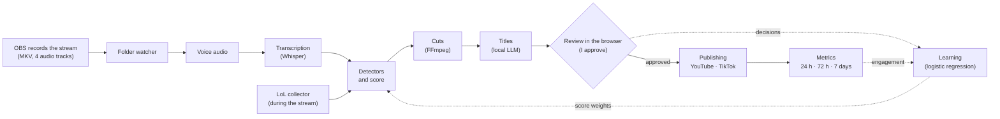

# Clipador: a live stream clipper

*[Leia em português](README.md)*

[](https://github.com/Fermontelos/Clipador/actions/workflows/ci.yml)


[](LICENSE)

I stream League of Legends on Twitch for about 3 hours a day, and clipping the best moments
by hand was taking longer than the stream itself. So I built Clipador. It takes the OBS
recording, finds the good moments overnight and has the clips ready for me to review in the
morning, keyboard only. Whatever I approve goes to YouTube and TikTok, and nothing goes out
without my approval.

Over time it learns from my choices and from what the audience actually watches. It's a
personal project that doubles as my portfolio, built only with free tools and APIs. The code,
docs and UI are in Portuguese (I'm Brazilian and stream in Portuguese); this page is an
English overview.


You can try the review in your browser, nothing to install:
[fermontelos.github.io/Clipador](https://fermontelos.github.io/Clipador/). The clips come from a
fake stream the app generates itself, and your decisions stay in your tab. There's also a
[one-minute video](docs/imagens/demo.mp4) of the whole flow.

## What it does

- Finds moments on its own. Three detectors scan the whole stream: peaks in my voice, what I
  say (transcribed with Whisper) and in-game LoL events, aligned to the second in the video.
  Each moment gets a score from 0 to 100.
- Cuts each moment horizontally and in two vertical layouts (blurred background, or webcam on
  top and game below), with captions and without the music, for copyright reasons.
- Suggests titles and hashtags with an LLM running on my own PC (Ollama), trying to sound like
  me.
- In the review I approve, reject, undo, trim the clip and change the title.
- Uploads to YouTube as private and scheduled, and sends verticals to TikTok as drafts or to a
  folder. There's a 10-minute window to undo before anything is uploaded.
- Learns: my approvals and the engagement of published clips turn into suggested score
  weights, which only apply if I accept them.
- Looks after the PC: starts when the stream ends, picks up where it stopped after a power
  cut, keeps Windows from sleeping mid-job and can shut the computer down at the end.

## How it works



Every step is a task in a queue stored in SQLite, so if the PC goes down halfway, the queue
resumes where it stopped. The code is split into four parts with a single dependency
direction (`frontend -> api -> backend -> integracoes`), and only the integrations ever touch
API keys. A test makes sure nobody breaks that by accident
([ADR 0003](docs/adr/0003-backend-api-integracoes-frontend.md)).

## Things I'm happy with

- Architecture rules checked by a test that parses the imports of each package.
- A crash-safe queue: workers claim tasks with a conditional `UPDATE` and check that exactly
  one row changed, and finishing a task and queueing the next one happen in the same commit.
- An undo that can't lose the race against the upload: cancelling is a single conditional
  `DELETE`, so either the undo wins or it's refused.
- A local API with no password that is still locked down: bound to `127.0.0.1`, checks the
  `Host` header (DNS rebinding) and rejects cross-site writes.
- Desktop OAuth with a loopback redirect, `state` and PKCE.
- Learning that stays explainable: logistic regression gives one weight per detector, checked
  with cross-validation on data it didn't see. Engagement is normalised by the channel median
  and mixed with my own taste instead of replacing it.
- Whisper `medium` running on a 4 GB GTX 1050 Ti.
- Around 650 Python tests and 90 frontend tests, type-checked with mypy, CI on Windows and
  Linux, and 12 architecture decision records.

## Running the demo

No GPU and no accounts needed, just Git, [uv](https://docs.astral.sh/uv/) and FFmpeg
(`winget install Gyan.FFmpeg`). In PowerShell:

```powershell
git clone https://github.com/Fermontelos/Clipador.git; cd Clipador
$env:UV_NO_GROUP = "gpu"           # the demo doesn't use the GPU, so skip the NVIDIA libraries

uv run clipador demo               # creates a fake 3-minute stream
uv run clipador processar --demo   # finds moments, cuts clips, writes titles (about 2 min)
uv run clipador web --demo         # opens the review in the browser
```

The UI has to be built once with [Node.js](https://nodejs.org) 22.12+:
`cd frontend; npm ci; npm run build; cd ..`. Without it, the last command opens the API docs,
which can also be used to review.

The fake stream mimics a real one: the 4 OBS audio tracks, four shouts at known times, a LoL
match and a fake webcam in the corner. It also ships 6 older streams that were already
reviewed and "published" (all made up, database only), so the learning screens have something
to show.

## Learning, on the demo

> These numbers are made up. The demo history was built with a hidden "taste" on purpose, to
> see whether the learning could find it. I don't have data from real streams yet.


In the demo history, the audience engages most with LoL plays (index 1.53, against 1.13 for
shouts and 1.01 for speech, where 1 is a typical video on the channel), which is exactly the
kind of moment the demo streamer approves least. That's why the score mixes both.


Measured only on data the training didn't see: learning from approvals takes precision on the
top-scored moments from 56% to 65%, and learning from engagement takes the share of clips
above the channel median from 64% to 74%.

## Where it stands

Everything is implemented and tested, but some of it can only be confirmed with real streams
and accounts:

| Part | Status |
|---|---|
| Queue, audio, transcription, cuts, titles and review | ✅ work on the demo and already ran on 5 of my old recordings (with all the audio still mixed into one track) |
| LoL collector | ✅ tested in a real match; ⏳ still need to check the alignment on a recorded stream |
| Detectors and score | ✅ on the demo and old recordings; ⏳ need a stream with the voice on its own track |
| Automatic shutdown | ✅ in test mode; ⏳ need one real night |
| Learning from decisions | ✅ on the demo; ⏳ needs 100 of my own decisions |
| YouTube | 🟡 tested against a simulated YouTube; first real upload pending |
| TikTok | 🟡 folder export works; drafts tested against a simulated TikTok |
| Engagement metrics | 🟡 tested with simulated APIs; real metrics pending |

## Known limitations

- Windows only: starting at login, keeping the PC awake and shutting it down use Windows APIs.
- The learning numbers above come from the demo.
- The model only learns from what I reviewed, and I mostly review high-scoring moments. A kind
  of moment the detector never suggests never becomes an example.
- Engagement depends on timing, trends and the algorithm, and swings a lot with few videos.
  Hashtags and title types are correlation, not causation, so they only reorder suggestions.
- TikTok can't post on its own: Direct Post requires an audit that doesn't accept tools for
  your own accounts ([ADR 0011](docs/adr/0011-tiktok-pasta-e-rascunho.md)).
- My GTX 1050 Ti can't use NVENC with FFmpeg 9, so clips are encoded on the CPU
  ([ADR 0006](docs/adr/0006-cortes-no-processador-sem-nvenc.md)).
- LoL is the only game with an event detector; other games get scored on voice and speech.

## Stack

Python 3.12, uv workspace, SQLite + SQLModel + Alembic, FastAPI, Typer, faster-whisper (CUDA
12), FFmpeg, Ollama (qwen3:4b), scikit-learn, httpx, Google API client, React 19 + Vite +
TypeScript + Tailwind + Recharts, pytest + Vitest, ruff, mypy, GitHub Actions.

## Architecture decision records (in Portuguese)

| ADR | Decision |
|---|---|
| [0001](docs/adr/0001-python-sqlite-fastapi.md) | Python, SQLite and FastAPI |
| [0002](docs/adr/0002-sqlite-e-nao-postgres.md) | SQLite rather than PostgreSQL |
| [0003](docs/adr/0003-backend-api-integracoes-frontend.md) | Four parts, one dependency direction, keys in one place |
| [0004](docs/adr/0004-abrir-no-login-pela-chave-run.md) | Start at login through the registry `Run` key |
| [0005](docs/adr/0005-detectores-devolvem-sinais.md) | Detectors return signals; one step builds the moments |
| [0006](docs/adr/0006-cortes-no-processador-sem-nvenc.md) | Encode on the CPU when NVENC doesn't work |
| [0007](docs/adr/0007-api-local-sem-senha.md) | A local review API without a password, and how it's protected |
| [0008](docs/adr/0008-vertical-b-camera-e-jogo.md) | Vertical layout with the webcam on top |
| [0009](docs/adr/0009-regressao-logistica.md) | Logistic regression for the score weights |
| [0010](docs/adr/0010-publicacao-agendada-com-tempo-para-desfazer.md) | Scheduled publishing with time to undo |
| [0011](docs/adr/0011-tiktok-pasta-e-rascunho.md) | TikTok through a folder and drafts |
| [0012](docs/adr/0012-engajamento-ensina-a-nota.md) | Engagement teaches the score without erasing my taste |

## License

[MIT](LICENSE)
