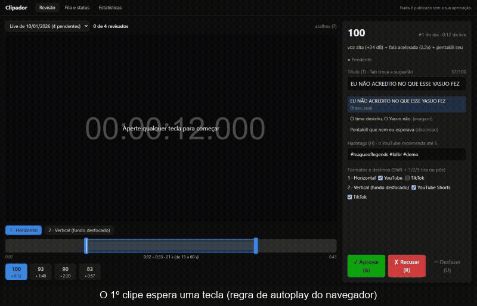
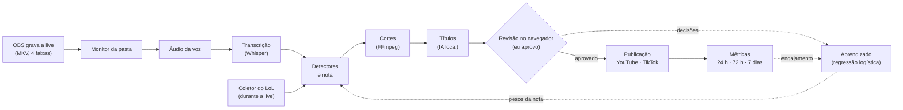

# Clipador de lives

*[Read in English](README.en.md)*

[](https://github.com/Fermontelos/Clipador/actions/workflows/ci.yml)


[](LICENSE)

Faço umas 3 horas de live de LoL por dia na Twitch, e cortar os melhores momentos à mão estava
me tomando mais tempo que a própria live. Então fiz o Clipador: ele pega a gravação do OBS,
acha os momentos bons durante a madrugada e deixa os clipes prontos para eu revisar de manhã,
só pelo teclado. O que eu aprovo vai para o YouTube e o TikTok. Nada sai sem eu aprovar.

Com o tempo ele aprende com as minhas escolhas e com o que o público de fato assiste. É um
projeto pessoal, que também uso como portfólio, e só usa ferramentas e APIs gratuitas.



Dá para testar a revisão direto no navegador, sem instalar nada:
[fermontelos.github.io/Clipador](https://fermontelos.github.io/Clipador/). Os clipes são de
uma live falsa que o próprio app gera, e as suas decisões ficam só na sua aba. Tem também um
[vídeo de 1 minuto](docs/imagens/demo.mp4) com o fluxo inteiro.

## O que ele faz

- Acha os momentos sozinho. Três detectores olham a live inteira: os picos da minha voz, o
  que eu falo (transcrito pelo Whisper) e os eventos da partida de LoL, alinhados ao segundo
  do vídeo. Cada momento ganha uma nota de 0 a 100.
- Corta cada momento na horizontal e em dois formatos verticais (um com fundo desfocado,
  outro com a câmera em cima e o jogo embaixo), com legenda e sem a música, por causa dos
  direitos autorais.
- Sugere títulos e hashtags com uma IA que roda no meu PC (Ollama), tentando imitar o meu
  jeito de escrever.
- Na revisão eu aprovo, recuso, desfaço, ajusto o início e o fim do corte e troco o título.
- Publica no YouTube como privado e agendado, e no TikTok manda para uma pasta ou como
  rascunho. Antes de qualquer envio há 10 minutos para desfazer.
- Aprende: as minhas aprovações e o engajamento dos vídeos viram sugestões de pesos para a
  nota. Só mudam se eu aceitar.
- Cuida do PC: começa quando a live termina, continua de onde parou se a luz cair, não deixa
  o Windows suspender no meio e pode desligar o computador no fim.

## Como funciona



Cada passo é uma tarefa numa fila guardada no SQLite. Se o PC desliga no meio, a fila continua
de onde parou quando ele volta. O código é dividido em quatro partes que só dependem numa
direção (`frontend -> api -> backend -> integracoes`), e só as integrações tocam nas chaves das
APIs. Um teste garante que ninguém quebre isso sem querer
([ADR 0003](docs/adr/0003-backend-api-integracoes-frontend.md)).

## Rodando a demo

Não precisa de placa de vídeo nem de conta em nada, só Git, [uv](https://docs.astral.sh/uv/) e
FFmpeg (`winget install Gyan.FFmpeg`). No PowerShell:

```powershell
git clone https://github.com/Fermontelos/Clipador.git; cd Clipador
$env:UV_NO_GROUP = "gpu"           # a demo não usa a placa, então pula as bibliotecas da NVIDIA

uv run clipador demo               # cria uma live falsa de 3 minutos
uv run clipador processar --demo   # acha os momentos, corta e gera os títulos (uns 2 min)
uv run clipador web --demo         # abre a revisão no navegador
```

Para a interface aparecer, ela precisa ser construída uma vez com o
[Node.js](https://nodejs.org) 22.12+: `cd frontend; npm ci; npm run build; cd ..`. Sem isso,
o último comando abre a documentação da API, que também serve para revisar.

A live falsa imita uma de verdade: as 4 faixas de áudio do OBS, quatro gritos em horários
conhecidos, uma partida de LoL e uma "câmera" no canto. Ela vem com 6 lives antigas já
revisadas e publicadas (tudo inventado, só no banco), para dar o que mostrar no aprendizado:
`uv run clipador aprender --demo` e `uv run clipador engajamento --demo`. A demo fica em
`dados/demo/`, separada do resto, e `--do-zero` recria tudo.

## O aprendizado, na demo

> Esses números são inventados. O histórico da demo foi montado com um "gosto" escondido
> justamente para ver se o aprendizado conseguia achá-lo. Ainda não tenho dados de lives reais.


No histórico da demo, o público engaja mais com as jogadas de LoL (índice 1,53, contra 1,13
dos gritos e 1,01 da fala, onde 1 é um vídeo típico do canal). E é justamente o tipo de
momento que o streamer da demo menos aprova. Por isso a nota mistura os dois.


Medindo só em dados que o treino não viu: aprendendo com as aprovações, a precisão nos
momentos de maior nota vai de 56% para 65%. Aprendendo com o engajamento, os cortes acima da
mediana do canal vão de 64% para 74%. Os gráficos saem de `docs/gerar_imagens.py`.

## Em que pé está

Tudo está implementado e testado, mas parte só se confirma com lives e contas de verdade:

| Parte | Situação |
|---|---|
| Fila, áudio, transcrição, cortes, títulos e revisão | ✅ funcionam na demo e já rodaram em 5 gravações antigas minhas (ainda com o áudio todo misturado numa faixa) |
| Coletor do LoL | ✅ testado numa partida real; ⏳ falta conferir o alinhamento numa live gravada |
| Detectores e nota | ✅ na demo e nas gravações antigas; ⏳ falta uma live com a voz separada |
| Desligar o PC sozinho | ✅ em modo de teste; ⏳ falta uma noite de verdade |
| Aprendizado com as decisões | ✅ na demo; ⏳ precisa de 100 decisões minhas |
| YouTube | 🟡 testado contra um YouTube simulado; falta o primeiro envio real |
| TikTok | 🟡 a pasta funciona; o rascunho foi testado contra um TikTok simulado |
| Métricas de engajamento | 🟡 testadas com APIs simuladas; faltam métricas reais |

O que mudou em cada versão está nas [notas da versão](docs/release-v1.0.md). Na fila de ideias
estão o chat da Twitch como mais um sinal, outros jogos e descobrir os melhores horários para
postar.

## Limitações conhecidas

- Só roda no Windows, porque abrir no login, segurar a suspensão e desligar o PC usam APIs do
  Windows.
- Os números de aprendizado acima são da demo. O de verdade precisa de 100 decisões, e o de
  engajamento de 50 cortes com uma semana de métricas.
- O modelo só aprende com o que eu revisei, e eu reviso quase só os momentos de nota alta. Um
  tipo de momento que o detector nunca sugere nunca vira exemplo.
- Engajamento depende de horário, tendência e do algoritmo. Com poucos vídeos os números
  oscilam muito, e hashtags e tipos de título são correlação, não causa. Por isso eles só
  mudam a ordem das sugestões.
- O TikTok não posta sozinho. O post direto exige uma auditoria que não aceita ferramentas
  para as próprias contas ([ADR 0011](docs/adr/0011-tiktok-pasta-e-rascunho.md)).
- A minha GTX 1050 Ti não consegue usar o NVENC com o FFmpeg 9, então os cortes são feitos no
  processador ([ADR 0006](docs/adr/0006-cortes-no-processador-sem-nvenc.md)).
- O player da revisão só tem o último corte: se eu aumento o trecho, o pedaço novo só aparece
  depois que ele corta de novo.
- Só o LoL tem detector de eventos. Em outro jogo a nota usa só a voz e a fala.

## Usando com as suas lives

Precisa de Windows 10+, [uv](https://docs.astral.sh/uv/), Git e FFmpeg. Para transcrever na
placa de vídeo, uma NVIDIA com driver 570 ou mais novo; sem ela a transcrição roda no
processador, bem mais devagar (e `uv sync --no-group gpu` evita baixar as bibliotecas da
NVIDIA). Os títulos com IA são opcionais e usam o [Ollama](https://ollama.com) com o
`qwen3:4b`.

```powershell
git clone https://github.com/Fermontelos/Clipador.git
cd Clipador
uv sync
Copy-Item config.example.toml config.toml
uv run clipador config
```

No OBS, cada fonte de áudio precisa ir para uma faixa separada:

1. Em Configurações → Saída, use o modo Avançado. Na aba Gravação, escolha o formato mkv (ele
   não se perde se o OBS cair) e marque as faixas de áudio 1, 2, 3 e 4.
2. Capture o jogo e a música com uma "Captura de áudio de aplicativo" cada e desligue o
   "Áudio da área de trabalho", que mistura tudo.
3. Em Edição → Propriedades avançadas de áudio, coloque o microfone nas faixas 1 e 2, o jogo
   nas faixas 1 e 3 e a música nas faixas 1 e 4. A faixa 1 continua sendo a que vai para a
   live; o app usa as outras, e a música nunca entra nos clipes.

No `config.toml`, `pasta_gravacoes` é a pasta onde o OBS salva as lives e `[faixas]` diz o que
tem em cada faixa. Cada opção está explicada no próprio arquivo. Depois disso:

- `uv run clipador iniciar` liga o serviço (`clipador instalar-servico` faz ele abrir sozinho
  no login) e `uv run clipador web` abre a revisão.
- Para publicar, é preciso [ligar as contas do YouTube e do TikTok](docs/configurar-contas.md).
- Todos os comandos estão no [guia de uso](docs/guia.md).

## Desenvolvimento

```bash
uv run pytest -m "not lento"  # testes rápidos (os que o pre-commit roda)
uv run pytest --cov           # todos, com cobertura (o que a CI roda)
uv run ruff check             # lint
uv run ruff format            # formatação
uv run mypy                   # tipos
uv run pre-commit install     # roda lint, tipos e testes a cada commit
```

A interface fica em `frontend/` (React, Vite, TypeScript e Tailwind):

```bash
npm run dev             # com o "clipador web" aberto; recarrega a cada mudança
npm test                # testes do Vitest
npm run test:cobertura  # os mesmos, com cobertura
npm run build           # gera o frontend/dist que o "clipador web" serve
```

A demo do navegador é a mesma interface, num build que lê respostas gravadas da API em vez de
falar com o servidor. A cada push no `main`, o workflow `demo.yml` gera a demo, grava as
respostas e os vídeos com `docs/gerar_demo_estatica.py` e publica no GitHub Pages.

Mudou uma tabela em `backend/src/clipador/banco/modelos.py`? Gere a migração com
`uv run alembic revision --autogenerate -m "o que mudou"`.

A CI roda tudo isso a cada push: lint, tipos e testes com cobertura no Windows, e a interface no
Linux. Ela falha se a cobertura dos detectores, do alinhamento do LoL ou da interface cair abaixo
de 80%.

## Estrutura

```
backend/        a pipeline, o banco, a fila, o serviço, a demo e a linha de comando
  src/clipador/
    banco/        tabelas, fila, backup e migrações
    ingestao/     monitor da pasta do OBS e extração do áudio da voz
    transcricao/  Whisper e legendas
    jogo/         coletor do LoL e alinhamento com o vídeo
    detectores/   os detectores de momentos e a nota
    cortes/       os clipes e as thumbnails
    titulos/      títulos e hashtags (Ollama, com um plano B sem IA)
    sistema/      serviço, energia e abertura no login
    demo/         a live falsa
    revisao/      as regras da revisão
    aprendizado/  precisão e pesos da nota
    publicacao/   agenda, cota e envio ao YouTube e ao TikTok
    engajamento/  coleta das métricas e rankings
api/            a API local da revisão (FastAPI) e o comando "clipador web"
integracoes/    YouTube, TikTok e LoL; o único lugar que lê as chaves
frontend/       a interface da revisão (React)
tests/          testes de arquitetura (as regras entre as partes)
docs/           guias, decisões técnicas (docs/adr/) e as imagens do README
```

As três partes em Python formam um workspace do uv: cada uma tem o próprio `pyproject.toml`,
mas tudo é instalado e testado junto, a partir da raiz.

## Decisões técnicas

Fui registrando as decisões maiores em ADRs curtos, com o que considerei e por que escolhi:

- [0001: Python, SQLite e FastAPI](docs/adr/0001-python-sqlite-fastapi.md)
- [0002: SQLite e não PostgreSQL](docs/adr/0002-sqlite-e-nao-postgres.md)
- [0003: backend, API, integrações e frontend separados](docs/adr/0003-backend-api-integracoes-frontend.md)
- [0004: abrir no login pela chave "Run" do registro](docs/adr/0004-abrir-no-login-pela-chave-run.md)
- [0005: detectores devolvem sinais, e a nota monta os momentos](docs/adr/0005-detectores-devolvem-sinais.md)
- [0006: cortar no processador quando o NVENC não funciona](docs/adr/0006-cortes-no-processador-sem-nvenc.md)
- [0007: API da revisão local, sem senha](docs/adr/0007-api-local-sem-senha.md)
- [0008: vertical com a câmera em cima e o jogo embaixo](docs/adr/0008-vertical-b-camera-e-jogo.md)
- [0009: regressão logística para aprender os pesos da nota](docs/adr/0009-regressao-logistica.md)
- [0010: publicação agendada, com tempo para desfazer](docs/adr/0010-publicacao-agendada-com-tempo-para-desfazer.md)
- [0011: TikTok pela pasta e por rascunho](docs/adr/0011-tiktok-pasta-e-rascunho.md)
- [0012: o engajamento ensina a nota, sem apagar o meu gosto](docs/adr/0012-engajamento-ensina-a-nota.md)

## Licença

[MIT](LICENSE)
