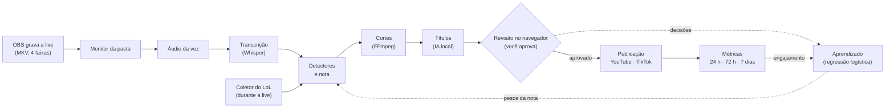

# Clipador de lives

[](https://github.com/Fermontelos/Clipador/actions/workflows/ci.yml)


[](LICENSE)

App em Python que transforma gravações de live (OBS) em clipes para YouTube e TikTok. O
processamento roda de madrugada; de manhã você revisa os clipes pelo teclado, numa interface
web local; e **nada é publicado sem a sua aprovação**. Com o tempo, o app aprende com as suas
aprovações e com o engajamento do público quais momentos viram bons cortes.

Projeto pessoal e de portfólio (nome provisório), feito só com ferramentas e APIs gratuitas.


O fluxo inteiro em 1 minuto, na demo: [vídeo (MP4, sem som)](docs/imagens/demo.mp4).

## O que ele faz

- **Acha os melhores momentos sozinho**: três detectores (plugins) olham a live inteira:
  picos da sua voz, expressões na transcrição (Whisper) e eventos do LoL coletados durante a
  partida, alinhados ao segundo do vídeo. Cada momento ganha uma nota de 0 a 100.
- **Corta em três formatos**: horizontal, vertical com fundo desfocado e vertical com a
  câmera em cima e o jogo embaixo; legenda da fala, áudio sem a música (direitos autorais) e
  volume no padrão das redes.
- **Sugere títulos e hashtags** com uma IA local (Ollama), no seu estilo, sem custo.
- **Revisão pelo teclado**: aprovar, recusar, desfazer, ajustar o corte, trocar o título.
- **Publica o que você aprovou**: no YouTube, privado e agendado (Shorts e vídeos); no
  TikTok, numa pasta ou como rascunho no app. Dá 10 minutos para desfazer antes do envio.
- **Aprende**: com as suas decisões (regressão logística, etapa 14) e com o engajamento dos
  cortes publicados (etapa 17), sugere novos pesos para a nota; nada muda sem o seu aceite.
- **Cuida do PC**: começa sozinho quando a live termina, continua de onde parou se a luz
  cair, não deixa o Windows suspender no meio e pode desligar o PC no fim da noite.

## Como funciona



Do áudio aos títulos, e cada envio e coleta de métricas, são tarefas numa **fila retomável em
SQLite**: se o PC desligar no meio, ela continua de onde parou. O código tem quatro partes com uma direção de dependência só
(`frontend -> api -> backend -> integracoes`), e um teste confere que a API nunca fala com as
redes sociais direto nem o backend lê as chaves ([ADR 0003](docs/adr/0003-backend-api-integracoes-frontend.md)).

## Demo em 3 comandos

Sem placa de vídeo, sem contas e sem configurar nada. Precisa do Git, do
[uv](https://docs.astral.sh/uv/) e do FFmpeg (`winget install Gyan.FFmpeg`). No PowerShell:

```powershell
git clone https://github.com/Fermontelos/Clipador.git; cd Clipador
$env:UV_NO_GROUP = "gpu"           # a demo não usa a placa: pula ~1 GB de bibliotecas da NVIDIA

uv run clipador demo               # 1. cria uma live falsa de 3 min (~15 s)
uv run clipador processar --demo   # 2. momentos, 12 clipes e títulos (~2 min)
uv run clipador web --demo         # 3. abre a revisão no navegador
```

O `UV_NO_GROUP` vale só para esse terminal: para usar o app com a placa de vídeo (veja
abaixo), abra outro. A interface é construída uma vez, com o [Node.js](https://nodejs.org)
22.12 ou mais novo (`winget install OpenJS.NodeJS.LTS`):
`cd frontend; npm ci; npm run build; cd ..`. Sem ela, o passo 3 abre a documentação
interativa da API, que também permite revisar.

A live falsa tem as mesmas 4 faixas de áudio do OBS (mistura, voz, jogo e música), quatro
picos de voz em horários conhecidos (0:25, 1:10, 1:58 e 2:30), eventos de uma partida de LoL,
uma "câmera" no canto, uma transcrição e títulos prontos. A demo traz também 6 lives antigas
já revisadas e "publicadas" (dados inventados, só no banco), para o aprendizado e o
engajamento terem o que mostrar: `uv run clipador aprender --demo` e
`uv run clipador engajamento --demo`. Ela usa uma pasta e um banco separados
(`dados/demo/`); `--do-zero` recria tudo. Para apresentar o app, há um
[roteiro de demonstração de 5 minutos](docs/roteiro-de-demonstracao.md).

## O aprendizado, na demo

> Os números abaixo são **inventados**: vêm do histórico da demo, que esconde de propósito um
> "gosto" conhecido, para mostrar o aprendizado funcionando. Ainda não há métricas de lives
> reais (veja as [limitações](#limitações-conhecidas)).


No histórico da demo, o público engaja mais com os **eventos do LoL** (índice médio 1,53,
contra 1,13 dos gritos e 1,01 da fala; 1 = o vídeo típico da rede), justamente o tipo de
momento que o streamer menos aprova.


Nos momentos de maior nota de cada dia, medidos em decisões e cortes que o treino não viu:
com as aprovações, a precisão vai de **56% para 65%**; com o engajamento, os cortes acima
da mediana do canal vão de **64% para 74%**. Os gráficos são gerados por
`uv run python docs/gerar_imagens.py`.

## Situação

As 18 etapas do roteiro estão feitas e testadas; algumas só se confirmam com lives e contas
reais:

| Parte | Situação |
|---|---|
| Banco e fila, demo, monitor da pasta, áudio, transcrição, cortes, títulos, API e interface da revisão (etapas 1–6, 9, 10, 12, 13) | ✅ testadas na demo; a pipeline (do áudio aos títulos) rodou também em 5 gravações reais antigas, só com a faixa da mistura |
| Coletor do LoL (etapa 7) | ✅ testado numa partida real; ⏳ falta conferir o segundo dos eventos numa live gravada |
| Detectores e nota (etapa 8) | ✅ na demo e nas gravações antigas; ⏳ falta uma live com a voz na faixa 2 |
| Desligar o PC sozinho (etapa 11) | ✅ em modo de teste; ⏳ falta uma noite real para conferir o log |
| Aprendizado com as decisões (etapa 14) | ✅ na demo; ⏳ falta o gráfico de lives reais (precisa de 100 decisões) |
| Publicar no YouTube (etapa 15) | 🟡 testado com o YouTube simulado; falta o 1º envio real |
| Publicar no TikTok (etapa 16) | 🟡 pasta pronta; rascunho testado com o TikTok simulado, falta o sandbox |
| Métricas de engajamento (etapa 17) | 🟡 testadas com as APIs simuladas e na demo; faltam métricas reais |

O roteiro completo, a stack e os riscos estão em
[`docs/Clipador - Stack e Ferramentas.pdf`](docs/Clipador%20-%20Stack%20e%20Ferramentas.pdf).
O que entrou na versão 1.0 está nas [notas da versão](docs/release-v1.0.md); o que vem
depois (chat da Twitch, outros jogos, melhores horários) está na etapa 19.

## Limitações conhecidas

- **Só Windows**: a abertura no login, a energia e o desligamento usam APIs do Windows.
- **Os números de aprendizado e de engajamento do README são da demo.** O aprendizado precisa
  de 100 decisões; o engajamento, de 50 cortes publicados com 7 dias de métricas.
- **O modelo aprende entre os momentos que o detector já achou bons**: só os revisados têm
  decisão, e quase todos são os de maior nota do dia.
- **Engajamento depende de horário, tendência e algoritmo**, e com poucos vídeos os números
  oscilam bastante (na demo, só mudar a ordem dos exemplos mudava a comparação). Hashtags e
  tipos de título são correlação, não causa: só mudam a ordem das sugestões.
- **O TikTok não posta sozinho**: o post direto exige uma auditoria que não aceita
  ferramentas para as próprias contas ([ADR 0011](docs/adr/0011-tiktok-pasta-e-rascunho.md)).
  O rascunho chega sem legenda, e as métricas só existem para vídeos públicos.
- **A GTX 1050 Ti não usa o NVENC** com o FFmpeg 9: os cortes são feitos no processador
  ([ADR 0006](docs/adr/0006-cortes-no-processador-sem-nvenc.md)).
- **O player da revisão só tem o último corte**: aumentar o trecho só aparece depois do novo
  corte (a tela avisa).
- **O LoL é o único jogo com detector de eventos**; em outro jogo, a nota usa a voz e a fala.

## Como usar com as suas lives

Requisitos: Windows 10+, [uv](https://docs.astral.sh/uv/), Git e FFmpeg
(`winget install Gyan.FFmpeg`). O uv instala o Python 3.12 se precisar. Para transcrever na
placa de vídeo: uma NVIDIA com driver 570 ou mais novo (as bibliotecas do CUDA 12, ~1 GB, vêm
com o `uv sync`); sem ela, a transcrição usa o processador, bem mais devagar, e
`uv sync --no-group gpu` pula esse download. Para os títulos com IA (opcional): o
[Ollama](https://ollama.com) com o modelo `qwen3:4b`. Para a interface: o Node.js, como na demo.

```powershell
git clone https://github.com/Fermontelos/Clipador.git
cd Clipador
uv sync
Copy-Item config.example.toml config.toml
uv run clipador config
```

No OBS (uma vez), o app precisa de cada fonte de áudio numa faixa separada:

1. Em **Configurações → Saída**, use o modo de saída **Avançado** e, na aba **Gravação**,
   o formato **mkv** (um arquivo MKV não se perde se o OBS ou o PC caírem) e as **faixas de
   áudio 1, 2, 3 e 4** marcadas.
2. Capture o jogo e o player de música com uma **Captura de áudio de aplicativo** cada (OBS 28
   ou mais novo) e desative o "Áudio da área de trabalho", que mistura tudo.
3. Em **Edição → Propriedades avançadas de áudio**, ponha o microfone nas faixas 1 e 2, o
   jogo nas faixas 1 e 3 e a música nas faixas 1 e 4. A faixa 1 é a mistura, a que vai para a
   live (em **Saída → Transmissão**, ela continua sendo a faixa de áudio); o app usa as faixas
   2 a 4, e a música nunca entra nos clipes.

Edite o `config.toml` (cada opção está explicada nele): `pasta_gravacoes` é a pasta onde o
OBS salva as lives, e `[faixas]` diz em que faixa está cada fonte (o padrão é 1 = mistura,
2 = voz, 3 = jogo, 4 = música). Caminhos relativos são contados a partir da pasta do
`config.toml`. Depois:

- `uv run clipador iniciar` liga o serviço (ou `clipador instalar-servico`, para ele abrir
  sozinho no login do Windows); `uv run clipador web` abre a revisão de manhã.
- Para publicar e coletar as métricas, ligue as contas: [configurar o YouTube e o
  TikTok](docs/configurar-contas.md).
- Todos os comandos e o que cada parte faz, em detalhe: o [guia de uso](docs/guia.md).

## Desenvolvimento

```bash
uv run pytest -m "not lento"  # testes rápidos (o pre-commit roda estes)
uv run pytest              # todos, inclusive a demo real de 3 min
uv run pytest --cov        # todos, com a cobertura (a CI roda este; --cov-report=html: htmlcov/)
uv run ruff check          # lint
uv run ruff format         # formatação
uv run pre-commit install  # a cada commit: lint, formatação, testes rápidos e, se o
                           # frontend mudou, os tipos e os testes do Vitest
```

As imagens do README (os gráficos da demo e o selo da cobertura) saem de um script:

```bash
uv run pytest --cov --cov-report=json:dados/cobertura.json
uv run python docs/gerar_imagens.py --cobertura
```

A interface (em `frontend/`, React + Vite + TypeScript + Tailwind):

```bash
npm run dev        # em frontend/, com o "clipador web" aberto: recarrega a cada mudança
npm test           # testes do Vitest (atalhos, desfazer, contador, ajuste do corte)
npm run build      # gera frontend/dist, que o "clipador web" serve
```

No `npm run dev`, o Vite (em `127.0.0.1:5173`) repassa `/api` para o `clipador web`
(porta 8765; outra: `CLIPADOR_API=http://127.0.0.1:PORTA`).

Depois de mudar uma tabela em `backend/src/clipador/banco/modelos.py`, gere a migração do banco:

```bash
uv run alembic revision --autogenerate -m "o que mudou"
```

A CI (GitHub Actions) roda lint, formatação e testes com a cobertura em Windows a cada push
(e falha se os detectores ou o alinhamento do LoL tiverem menos de 80%), e os tipos, os
testes e o build da interface em Linux.
Nenhum teste pode passar de 5 minutos (`pytest-timeout`): um teste travado falha mostrando
onde parou. Os testes nunca mexem na abertura no login de verdade: usam uma chave de teste
do registro, apagada no fim.

## Estrutura

O projeto é dividido em quatro partes, com uma direção de dependência só
([ADR 0003](docs/adr/0003-backend-api-integracoes-frontend.md)):

```
frontend ──(HTTP)──> api ──> backend ──> integracoes ──> YouTube / TikTok / LoL
```

```
backend/        pipeline, banco, fila, serviço, demo e a linha de comando (pacote clipador)
  src/clipador/
    banco/      tabelas, fila, backup e migrações (Alembic)
    ingestao/   monitor da pasta do OBS, horário de início e extração do áudio da voz
    transcricao/ Whisper na placa de vídeo, transcrição em blocos e legenda .srt
    jogo/       coletor do LoL, eventos seus e alinhamento com o tempo da gravação
    detectores/ detectores de momentos (plugins) e a nota de cada momento
    cortes/     clipes horizontal e vertical, legenda do clipe e thumbnail
    titulos/    títulos e hashtags com a IA local (Ollama) e o plano B sem IA
    sistema/    serviço em segundo plano, energia, trava e abertura no login
    demo/       roteiro e gerador da live falsa
    revisao/    regras da revisão: momentos do dia, decisões, ajuste do corte e cota
    aprendizado/ precisão, pesos da nota (regressão logística, pelo gosto e pelo
                engajamento) e janela do corte
    publicacao/ fila, agenda, pedido, cota e envio ao YouTube e ao TikTok
    engajamento/ coleta das métricas, índice, rankings de hashtags e títulos
    ffmpeg.py   chamadas ao FFmpeg e ao ffprobe
  tests/
api/            API local da revisão, FastAPI (etapa 12) e o comando clipador web
integracoes/    YouTube, TikTok e LoL (etapas 7, 15-17): único código que lê as chaves
frontend/       interface de revisão, React (etapa 13): nunca guarda chaves
  src/revisao/  a tela de revisão: atalhos, ajuste do corte e estado (funções puras)
  src/telas/    fila e status, estatísticas e engajamento (Recharts)
tests/          testes de arquitetura (as regras entre as partes)
conftest.py     proteções de todos os testes: nenhum abre o Whisper ou o Ollama de verdade,
                mexe na abertura no login ou desliga o PC
docs/           guias, roteiro em PDF, decisões técnicas (docs/adr/) e as imagens do README
dados/          banco, backups, logs, clipes, temporários e a demo (fora do git, criado pelo app)
```

As três partes Python formam um workspace do uv: cada uma tem o próprio `pyproject.toml`,
mas todas são instaladas juntas por `uv sync` e testadas juntas por `uv run pytest`, sempre
a partir da raiz. As regras de segurança (por exemplo, a API nunca importar as integrações)
são conferidas automaticamente em `tests/test_arquitetura.py`.

## Decisões técnicas

As perguntas mais comuns sobre o projeto (por que SQLite, como a fila sobrevive a uma queda,
por que regressão logística...) estão respondidas em [perguntas técnicas](docs/perguntas-tecnicas.md).

- [ADR 0001: Python + SQLite + FastAPI](docs/adr/0001-python-sqlite-fastapi.md)
- [ADR 0002: SQLite e não PostgreSQL](docs/adr/0002-sqlite-e-nao-postgres.md)
- [ADR 0003: backend, API, integrações e frontend separados](docs/adr/0003-backend-api-integracoes-frontend.md)
- [ADR 0004: abrir no login pela chave "Run"](docs/adr/0004-abrir-no-login-pela-chave-run.md)
- [ADR 0005: detectores devolvem sinais, e a nota monta os momentos](docs/adr/0005-detectores-devolvem-sinais.md)
- [ADR 0006: cortar no processador quando o NVENC não funcionar](docs/adr/0006-cortes-no-processador-sem-nvenc.md)
- [ADR 0007: API da revisão local, sem senha](docs/adr/0007-api-local-sem-senha.md)
- [ADR 0008: vertical B com a câmera em cima e o jogo embaixo](docs/adr/0008-vertical-b-camera-e-jogo.md)
- [ADR 0009: regressão logística para aprender os pesos da nota](docs/adr/0009-regressao-logistica.md)
- [ADR 0010: publicação agendada no YouTube, com tempo para desfazer](docs/adr/0010-publicacao-agendada-com-tempo-para-desfazer.md)
- [ADR 0011: TikTok pela pasta e por rascunho, post direto só após a auditoria](docs/adr/0011-tiktok-pasta-e-rascunho.md)
- [ADR 0012: o engajamento ensina a nota, misturado com o seu gosto](docs/adr/0012-engajamento-ensina-a-nota.md)

## Licença

[MIT](LICENSE)
